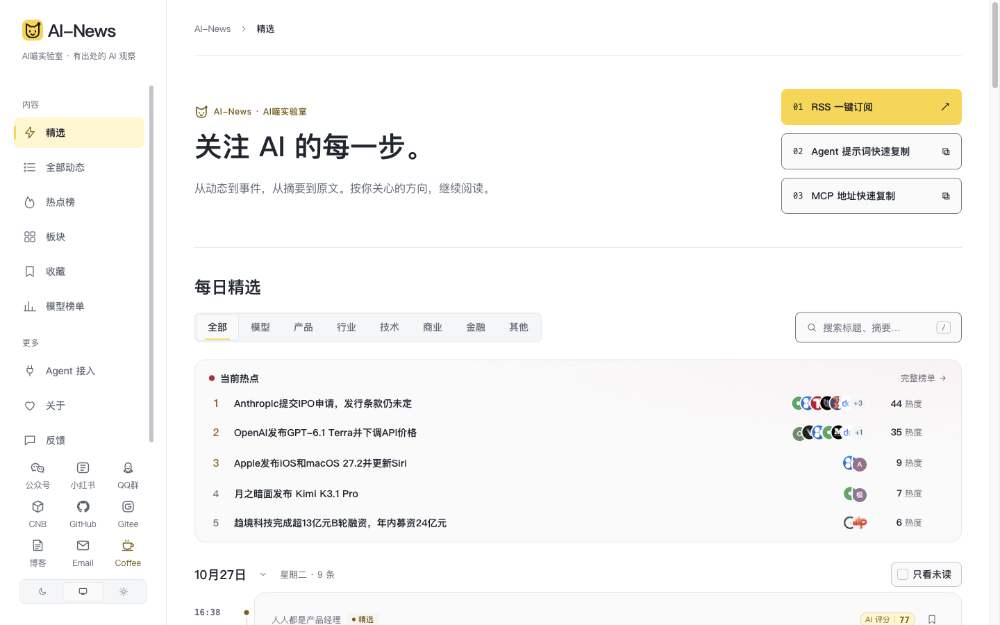
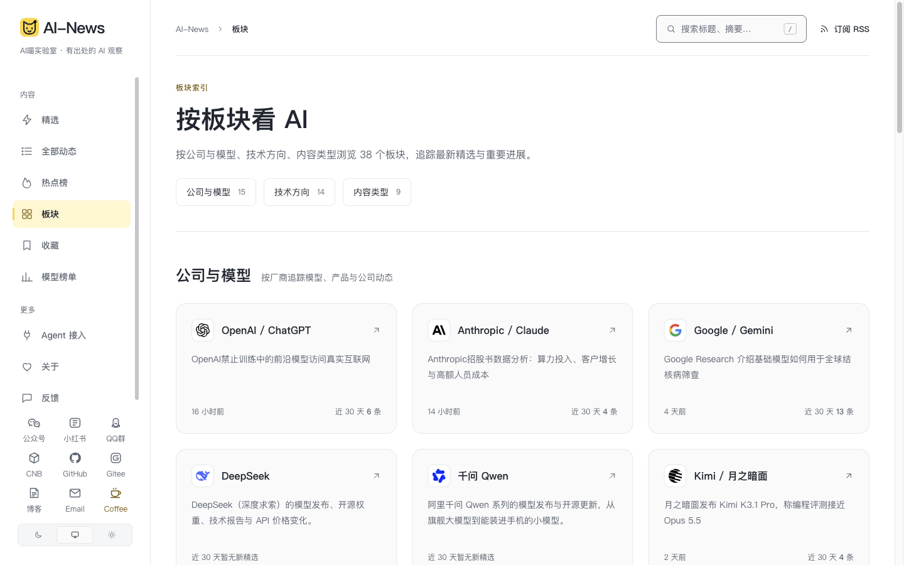
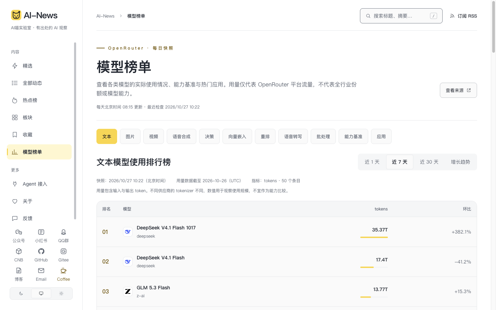

# AI-News · AI喵实验室

**有出处的 AI 观察。** AI-News 是一个自托管的行业资讯站：从国内外公开信源收集动态，整理中文阅读内容，将相关报道归组为事件，并提供精选、热点、模型榜单及日报、周报、月报。

[访问网站](https://news.echohaoran.top/) · [English](README.en.md) · [安装部署](docs/deploy.md) · [开发指南](docs/开发.md) · [Agent 接入](https://news.echohaoran.top/agent)



> 截图采集于 2026 年 10 月 28 日，内容和统计数字会随采集与处理变化。收录、模型整理和入选均不等于独立事实核验；请通过文章中的原文链接核对来源。

## 在这里可以做什么

- **阅读动态**：在[精选](https://news.echohaoran.top/)和[全部动态](https://news.echohaoran.top/all)中按模型、产品、行业、技术、商业、金融等分类浏览；文章页提供中文整理内容、来源链接和可跳转目录。素材或整理稿尚未就绪时，页面会显示相应状态。
- **追踪事件**：在[热点榜](https://news.echohaoran.top/hot)查看多方讨论的事件，在[板块](https://news.echohaoran.top/topics)按公司、模型和技术方向查找内容。
- **查看模型榜单**：[模型榜单](https://news.echohaoran.top/rankings)展示 OpenRouter 公开使用量、能力基准和应用数据。使用量仅反映该平台数据，不等同于模型能力或全行业份额。
- **按周期阅读**：支持[日报](https://news.echohaoran.top/daily)、[周报](https://news.echohaoran.top/weekly)和[月报](https://news.echohaoran.top/monthly)，内容取决于实际采集、处理与成刊结果。
- **订阅与工具**：提供 RSS、公开 API、Agent Markdown 和 MCP。MCP 地址需要添加到支持远程 MCP 的客户端连接配置，直接粘贴到聊天框不会自动建立连接。
- **个性化阅读**：支持搜索、收藏、浅色和深色主题；手机底栏提供精选、热点与我的。

| 板块 | 模型榜单 |
| --- | --- |
|  |  |

<details>
<summary>查看手机界面</summary>


</details>

## 内容如何产生

1. **采集**：按信源配置收集公开资料，保留来源、原文链接及可确认的时间；[来源动态·未核验](https://news.echohaoran.top/source-news)展示尚未经编辑流程的素材。
2. **处理**：worker 按相关性与评分规则筛选，生成摘要和中文整理稿，关联相同事件；付费模型请求经过回执和预算控制。
3. **发布**：网页、RSS、API、Agent Markdown 与 MCP 使用统一的公开读取层。访问页面不会触发采集或模型调用。

仓库的 `industry/sources.json` 包含 203 个信源配置；实际启用数量和更新情况以部署环境为准。中文整理稿由后台基于取得的素材生成，来源全文展示和再分发各有独立许可设置；图片代理会尝试识别并隐藏含可解码二维码的文章图片。详见[内容流程](docs/内容流程.md)、[中文整理稿](docs/frontend/中文整理稿.md)和[信源说明](docs/sources.md)。

## 自行部署

需要 Docker Engine、支持 `include` 的 Compose v2，或 Node.js **24.22.1 及以上**、npm 和 PostgreSQL 17。新环境从可移植模板开始：

```bash
git clone https://github.com/echohaoran/AI-Meow-News.git
cd AI-Meow-News

mkdir -p ../ai-news-runtime/data
cp deploy/portable/compose.env.example ../ai-news-runtime/compose.env
cp deploy/portable/backend.env.example ../ai-news-runtime/backend.env
chmod 600 ../ai-news-runtime/*.env
```

填写仓库外的环境文件后，按[新机器部署指南](docs/deploy.md)构建镜像、迁移、初始化信源并启动。默认模板只运行网页、API 和数据库，采集及模型调用关闭；完整 worker 需要单独评估模型路由、预算和历史队列。已有部署请按其现有 Compose 上下文操作，不要额外创建生产数据库。

## 目录与文档

技术栈包括 React、React Router SSR、Fastify、TypeScript、PostgreSQL 和 pg-boss。完整专题列表见[文档导航](docs/README.md)。

| 路径 | 用途 |
| --- | --- |
| `apps/web`、`apps/api`、`apps/worker` | 网页、HTTP 接口与后台任务 |
| `packages/backend`、`packages/contracts` | 采集、处理、发布读取层和共享契约 |
| `site`、`industry`、`modules` | 站点品牌与配置、行业规则、站点模块 |
| `database/migrations`、`deploy` | 数据库迁移和部署模板 |

- [架构与目录](docs/项目架构.md) · [引擎架构](docs/architecture.md) · [API 契约](docs/backend/API契约.md)
- [配置参考](docs/配置参考.md) · [部署与维护](docs/部署与维护.md) · [本地开发](docs/开发.md)
- [信源](docs/sources.md) · [精选与校准](docs/selection.md) · [事件归组](docs/grouping.md) · [模型榜单](docs/openrouter-rankings.md)
- [行业定制](docs/customize.md) · [运行快照](docs/验收与现状.md) · [历史交接](docs/handoff.md)

运行状态会变化：容器启动、信源抓取成功和模型可用是不同的检查项。2026 年 10 月 28 日的模型接口故障和排查线索见[运行快照](docs/验收与现状.md)；不要依据历史截图或部署记录判断当前服务是否健康。

## 贡献与许可

提交问题或修改前请阅读[贡献指南](CONTRIBUTING.md)；安全问题请按[安全报告说明](SECURITY.md)处理。不要提交密钥、生产数据或未经授权的素材。

项目基于 [AIHOT](https://github.com/KKKKhazix/AIHOT) 开源底座，保留 [MIT LICENSE](LICENSE)、[NOTICE](NOTICE) 及提交历史。代码许可不授予第三方文章、商标或素材的转载权利。
