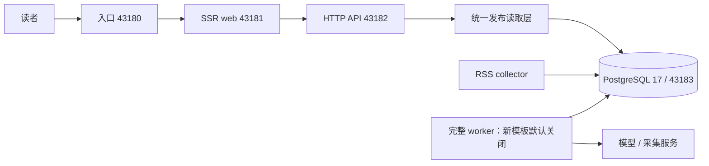

# 项目架构

[返回 README](../README.md)

web 只通过 HTTP 读取 API；数据库连接、模型密钥、管理员凭据及 `/data` 只交给后端。所有公开网页、RSS、API、Agent Markdown 与 MCP 共用 `packages/backend/src/publication` 的可公开性规则，管理员不会在公开页面看到额外私有内容。

| 目录 | 职责 |
|---|---|
| `apps/web` | React Router SSR、客户端交互、API 代理、阅读及后台页面 |
| `apps/api` | Fastify 路由、认证、CSRF、公开出口 |
| `apps/worker` | 完整处理器、独立 RSS collector、有界运维命令 |
| `packages/backend` | 收录、提取、模型回执/预算、编辑、事件、报告、发布 |
| `packages/contracts` | HTTP 与站点配置的共享类型 |
| `site` / `industry` | 品牌/站点模型路由；分类、来源、提示词与门槛 |
| `database/migrations` | 按完整文件名记录的 SQL 迁移，模块也可有迁移 |
| `deploy/portable` | 新机器独立部署的脱敏模板 |
| `deploy/ai-news` | 既有 homelab 入口和受控诊断工具；部分绑定特定路径/库名 |

完整 worker 会注册正文、分析、归组、综述、热点、报告和其他定时任务；RSS collector 只注册 `sources.fetch` 和每分钟的 `cron.sources.schedule`，抓取并发 2。它们共用 PostgreSQL 的 pg-boss 持久队列，不能通过增加重复角色“加速”同一批事务。

| 端口 | 可移植部署 | 既有部署边界 |
|---|---|---|
| 43180 | 默认只绑定宿主 loopback | 唯一 LAN 网页入口 |
| 43181 / 43182 | web / API，仅容器网络 | 同左 |
| 43183 | 生产数据库，仅内部网络 | 同左，不发布到 LAN |
| 43184 | 可选宿主开发库 loopback | 与生产分离 |

完整事务、在线迁移与模块机制参见[引擎架构](architecture.md)。运行数据、env、依赖缓存、构建结果、原始日志与内部验收记录不属于公开源码；镜像版本与 Git 提交分别记录，文档提交不会替换运行镜像。
